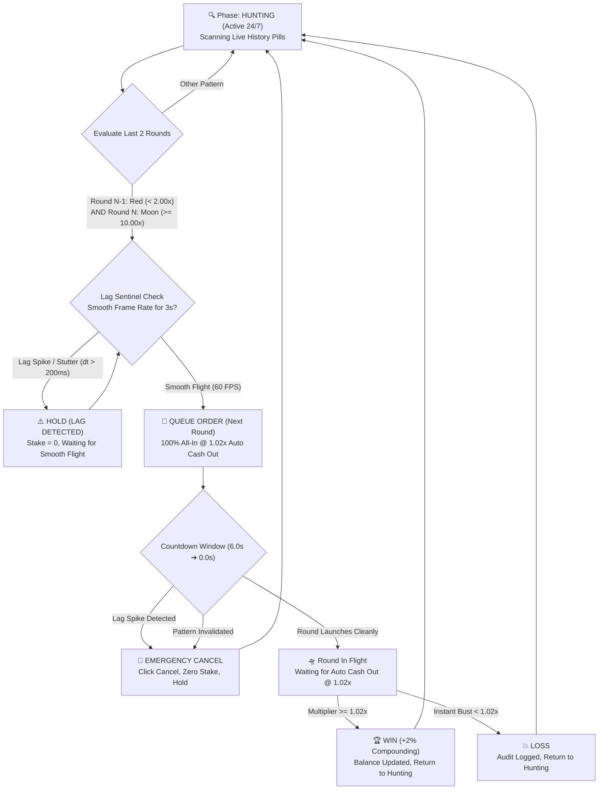

# PROJECT_CORE.md: BC.Game Crash SafeBot Core Architecture

> [!CRITICAL]
> **IMMUTABLE CORE SPECIFICATION FOR BC.GAME CRASH SAFEBOT**
> This document defines the exact architecture, rules, pattern detection, lag sentinels, and emergency fail-safes.
> No agent may alter these rules unless explicitly ordered by the user.

---

## 1. Executive Summary & Purpose

The BC.Game Crash SafeBot is an autonomous, zero-token in-browser engine designed to capture high-probability compounding growth while guarding against the two most lethal vulnerabilities in Crash multiplier environments:
1. **Lag & Desynchronization Traps**: Executing orders during browser frame drops, packet loss, or canvas freezes where cashout requests fail to register.
2. **Timing & Stagnation Traps**: Staking during unverified market phases without clear momentum signals.

The engine executes the **Red ➔ Moon Protocol**:
* **The Mathematical Edge**: At **`1.02×`**, the baseline mathematical win probability of any individual round is **`97.06%`** ($99 / 102$).
* **The Momentum Signal**: By entering only on the immediate round after a **Moon ($\ge 10.00\times$)** that was preceded by a **Red ($1.00\times - 1.99\times$)**, the engine targets momentum transitions.
* **Continuous Active Hunting**: Uncapped hourly limits allow the bot to actively hunt 24/7 whenever the trigger pattern presents itself.
* **Pre-Flight Lag & Motion Sentinel**: Uses real-time `requestAnimationFrame` delta tracking to hold execution whenever the Crash curve/countdown stutters.
* **Emergency Abort**: Automatically clicks "Cancel" on a queued order if lag strikes or pattern invalidates before the round starts.

---

## 2. Immutable Operational Rules

| Rule | Specification | Guardrail Enforcement |
| :--- | :--- | :--- |
| **Auto Cash Out** | **`1.02×`** | Hardcoded. Never increased for "extra profit" or reduced below 1.02x. |
| **Stake Allocation** | **100% All-In Compounding (Just-In-Time)** | Amount input is strictly zeroed (`0`) during hunting, populated with 100% balance upon Moon pattern trigger, and wiped back to `0` immediately upon settlement. |
| **Cadence Limit** | **Continuous Active Hunting** | No hourly restriction. Hunts 24/7 across all market cycles. |
| **Pattern Trigger** | **`Red` ➔ `Moon` (Exclude `Moon ➔ Red ➔ Moon`)** | **Round $N-2$**: Must **NOT** be Moon ($< 10.00\times$).<br/>**Round $N-1$**: Red ($1.00\times - 1.99\times$).<br/>**Round $N$**: Moon ($\ge 10.00\times$). |
| **Execution Point** | **Immediate Next Round (Round $N+1$)** | Order executed for the round immediately following the Moon crash. |
| **Lag & Motion Sentinel** | **Real-Time Frame Rate Monitor** | Tracks frame deltas via `requestAnimationFrame`. If $\Delta t > 200\text{ms}$, flags lag and holds orders. Requires 3s clean flight to clear. |
| **Emergency Abort** | **Queued Order Cancellation** | If an order is queued and lag strikes or pattern verification fails, clicks **`Cancel`** immediately before the round launches. |

---

## 3. System Architecture & Components

```
bc-game-crash-safebot/
├── crash-agent/
│   ├── config.json              # Platform & logging configuration
│   ├── data/
│   │   └── hourly.jsonl         # Compounding audit ledger & execution records
│   └── src/
│       └── in-page-engine.js    # Master in-browser DOM automation engine
├── skills/
│   └── bc-game-crash-safebot/
│       └── SKILL.md             # Autonomous operational runbook & skills spec
├── PROJECT_CORE.md              # Project architectural blueprint (this file)
└── AGENTS.md                    # Immutable directives for all AI agents
```

---

## 4. State Machine Diagram



---

## 5. In-Page Zero-Token Operations & Disaster Recovery

* **Zero Token Burn**: The engine operates purely inside the Chromium DOM via `setInterval` and `requestAnimationFrame`. No background LLM tool polling loops.
* **Disaster Recovery**:
  1. Open BC.Game Crash tab: `https://bc.game/game/crash`.
  2. Inject `crash-agent/src/in-page-engine.js` via `preview_evaluate`.
  3. Confirm `#_crash_bot_panel` mounts and displays `RED ➔ MOON PROTOCOL (1.02×)` and `CONTINUOUS`.
