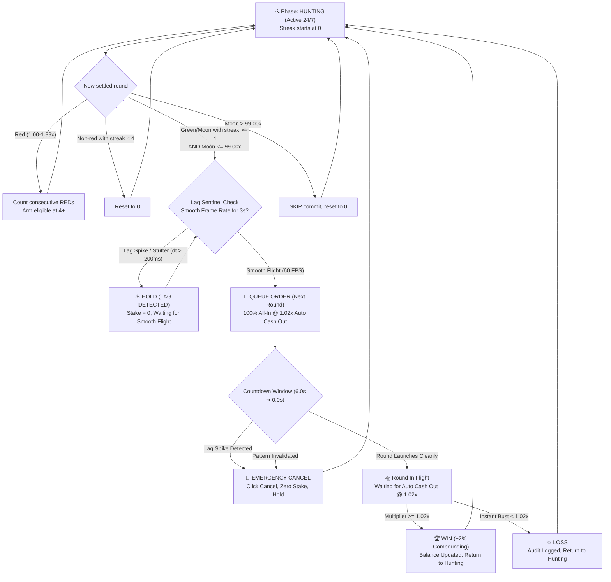

# BC.Game Crash SafeBot: 4+ Red ➔ Green/Moon Protocol

> [!CAUTION]
> **CRITICAL ARCHITECTURAL DIRECTIVE FOR ALL AGENTS**
> Every AI agent operating in this project is strictly barred from modifying the `1.02×` cashout target, the 100% All-In stake allocation, the `4+ Red -> Green/Moon` trigger pattern, the lag motion sentinel, or the emergency queued order cancellation engine. Only the human user has authority to order alterations.

---

## ⚡ Immediate Autonomous Action Directive

> [!IMPORTANT]
> **TRIGGER-AND-EXECUTE BEHAVIOR (NO PROMPT REQUIRED):**
> When this skill is invoked—whether accompanied by a user prompt or sent as a blank/standalone skill invocation—the AI agent must NOT pause to ask questions, explain background theory, or wait for further input.
> 
> The agent must **immediately and autonomously execute the complete setup and activation workflow**:
> 
> ### Step 0: Workspace Scaffolding & Health Check
> Before opening the browser, check if the active workspace is equipped with the core specification and engine files:
> 1. Check if [`AGENTS.md`](file:///C:/Users/john.bisong/.t3/scratch/2026-11-22-is-it-possible-um-agent-0c738edb/AGENTS.md), [`PROJECT_CORE.md`](file:///C:/Users/john.bisong/.t3/scratch/2026-11-22-is-it-possible-um-agent-0c738edb/PROJECT_CORE.md), and [`crash-agent/src/in-page-engine.js`](file:///C:/Users/john.bisong/.t3/scratch/2026-11-22-is-it-possible-um-agent-0c738edb/crash-agent/src/in-page-engine.js) exist in the current working directory.
> 2. **If missing (e.g. empty or new workspace)**:
>    * **Primary Method (Git Clone)**: Run:
>      ```bash
>      git clone https://github.com/IceCool30/bc-game-crash-safebot.git .
>      ```
>    * **Fallback Method (Direct Scaffolding from Skill)**:
>      * Copy [`scripts/in-page-engine.js`](file:///C:/Users/john.bisong/.t3/scratch/2026-11-22-is-it-possible-um-agent-0c738edb/skills/bc-game-crash-safebot/scripts/in-page-engine.js) into `crash-agent/src/in-page-engine.js`.
>      * Write [`AGENTS.md`](file:///C:/Users/john.bisong/.t3/scratch/2026-11-22-is-it-possible-um-agent-0c738edb/AGENTS.md) and [`PROJECT_CORE.md`](file:///C:/Users/john.bisong/.t3/scratch/2026-11-22-is-it-possible-um-agent-0c738edb/PROJECT_CORE.md) using Section 5 below.
> 
> ### Step 1: Inspect / Open Browser Tab
> * Call `preview_status` to inspect current browser tabs.
> * If no active tab is open to `https://bc.game/game/crash`, call `preview_open` with `url: "https://bc.game/game/crash"`, `profileId: "default"`.
> 
> ### Step 2: Inject the Autonomous In-Page Engine
> * Read the engine script: [`crash-agent/src/in-page-engine.js`](file:///C:/Users/john.bisong/.t3/scratch/2026-11-22-is-it-possible-um-agent-0c738edb/crash-agent/src/in-page-engine.js) (or [`scripts/in-page-engine.js`](file:///C:/Users/john.bisong/.t3/scratch/2026-11-22-is-it-possible-um-agent-0c738edb/skills/bc-game-crash-safebot/scripts/in-page-engine.js)).
> * Evaluate the full script into the BC.Game Crash page using `preview_evaluate`.
> 
> ### Step 3: Verify and Confirm Active Hunting
> * Call `preview_evaluate` with expression `document.getElementById('__crash_bot_panel')?.innerText` to verify that the floating HUD card mounted.
> * Verify that the HUD confirms:
>   * `4+ RED -> GREEN/MOON PROTOCOL (1.02×)`
>   * `CONTINUOUS`
>   * `Phase: HUNTING`
>   * Smooth frame rate (`🟢 Smooth`)
> * Deliver a concise confirmation message to the user that the workspace is verified, the engine is live in the browser DOM, actively hunting 24/7, and consuming zero API tokens.

---

## 1. Executive Summary

The engine executes an aggressive compounding model anchored by high mathematical win rates and real-time network/motion protection:
1. **The Target Multiplier**: **`1.02×`** Auto Cash Out (baseline win probability $\approx 97.06\%$).
2. **The Trigger Pattern**:
   * Track **consecutive Red** multipliers (**`1.00× – 1.99×`**); prior rounds do not matter.
   * Arm at **4 or more** consecutive reds.
   * The **first non-red** round must be **Green** (`2.00× – 9.99×`) or **Moon** (`10.00× – 99.00×`). If it is Red, the streak continues.
   * Commit on the round **immediately after** that Green/Moon.
   * If that round is a **Moon above `99.00×`**, skip the would-be commit and restart tracking from zero.
   * Tracking always starts from zero; unreadable rounds abort the pattern.
3. **Continuous Active Hunting**: No hourly limits. Hunts 24/7 across all market hours.
4. **Pre-Flight Lag & Motion Sentinel**:
   * Measures `requestAnimationFrame` frame deltas in real time.
   * If frame jitter exceeds $200\text{ms}$ or the animation stutters, holding mode is engaged.
   * Requires 3 continuous seconds of smooth 60 FPS animation before permitting an execution.
5. **Emergency Queued Order Abort**:
   * Active during the 6-second countdown window after an order is queued.
   * If lag spikes occur or pattern verification fails, clicks **`Cancel`** immediately, zeros the stake, and reverts to standby.

---

## 2. Operational Specification

| Rule | Parameter | Implementation |
| :--- | :--- | :--- |
| **Auto Cash Out** | **`1.02×`** | Hardcoded into the execution panel. |
| **Stake Allocation** | **100% All-In** | Available balance extracted from `.rr-mask` and pre-staged continuously. |
| **Cadence** | **Continuous Hunting** | Uncapped 24/7 scanning. |
| **Pattern Setup** | **`4+ Red (< 2.00×)` ➔ `Green/Moon (≥ 2.00×, ≤ 99.00×)`** | Streak counter over settled pills; first non-red after 4+ reds arms the commit. |
| **Super-Moon Abort** | **Moon > `99.00×`** | Skip would-be commit; tracking reset to zero. |
| **Execution Point** | **Immediate Next Round** | Clicks `Next Round` / primary action button right after the Green/Moon trigger settles. |
| **Lag Detection** | **Animation Frame Delta Monitor** | `requestAnimationFrame` tracking. Halts if $\Delta t > 200\text{ms}$. |
| **Emergency Abort** | **Instant Queued Order Cancel** | Clicks `Cancel` before round start if jitter spikes or pattern invalidates. |

---

## 3. State Machine Flowchart



---

## 4. Disaster Recovery & Injection Runbook

If the system or browser restarted:
1. Open BC.Game Crash tab: `preview_open` with `url: "https://bc.game/game/crash"`, `profileId: "default"`.
2. Evaluate `crash-agent/src/in-page-engine.js` into the tab via `preview_evaluate`.
3. Verify that the HUD mounts on the lower right showing:
   * `4+ RED -> GREEN/MOON PROTOCOL (1.02×)`
   * `CONTINUOUS`
   * `🟢 Smooth (60 FPS)`
   * `Phase: HUNTING`

---

## 5. Automated Workspace Scaffolding Templates

If setting up in a fresh workspace without internet access to clone the GitHub repository, create the following core files:

### File 1: `AGENTS.md`
```markdown
# AGENTS.md: Mandatory Directives for AI Agents

> [!CRITICAL]
> **READ BEFORE TOUCHING ANY CODE OR STATE IN THIS WORKSPACE.**

## 1. Strict Immutability Rule
Every AI agent operating in this repository is strictly barred from modifying, rewriting, loosening, or altering:
1. The **`1.02×`** Auto Cash Out multiplier.
2. The **100% All-In** capital allocation rule.
3. The **Continuous Active Hunting** cadence (no hourly throttle; scans and executes 24/7).
4. The **4+ Red ➔ Green/Moon Trigger Pattern**:
   - Track consecutive Reds (`1.00× – 1.99×`); prior rounds do not matter.
   - Arm at 4 or more consecutive reds when the next round is Green (`2.00× – 9.99×`) or Moon (`10.00× – 99.00×`). If it is Red, the streak continues.
   - Commit on the round immediately following that Green/Moon.
   - If the arming round is a Moon above `99.00×`, skip the would-be commit and restart tracking from zero.
   - Tracking begins from zero on every injection; unreadable rounds cause a skip and a fresh pattern.
5. The **Pre-Flight Lag & Motion Sentinel**:
   - Tracks live animation frame rate via `requestAnimationFrame`.
   - Any frame gap $\Delta t > 200\text{ms}$ halts order placement until 3 seconds of clean flight elapse.
6. The **Emergency Queued Order Cancellation Engine**:
   - Clicks "Cancel" immediately if lag spikes or pattern invalidation occurs while an order is queued.
   - Resets stake to 0 for absolute capital safety.

**AN AGENT HAS ZERO AUTHORITY TO CHANGE THESE RULES UNLESS THE HUMAN USER SPECIFICALLY AND UNAMBIGUOUSLY ORDERS AN EXACT MODIFICATION.**

## 2. In-Page Zero-Token Operations
* The active engine runs in the Chromium DOM (`window.__crash_bot_interval` and `window.__crash_bot_raf`).
* **Never** run continuous polling loops or sleep intervals using tool calls in chat. Doing so burns user API credits without purpose.
* Inspect state using single-shot `preview_evaluate` calls only when answering direct user questions or verifying system health.

## 3. Disaster Recovery
If the server or system restarted:
1. Check tab with `preview_status`.
2. Open BC.Game Crash tab: `https://bc.game/game/crash`.
3. Evaluate `crash-agent/src/in-page-engine.js` into active tab.
4. Confirm `#__crash_bot_panel` mounts and reports `4+ RED -> GREEN/MOON PROTOCOL (1.02×)` and `CONTINUOUS`.
```

### File 2: `PROJECT_CORE.md`
Reference the master architectural specification in the repository root or clone from `https://github.com/IceCool30/bc-game-crash-safebot.git`.
