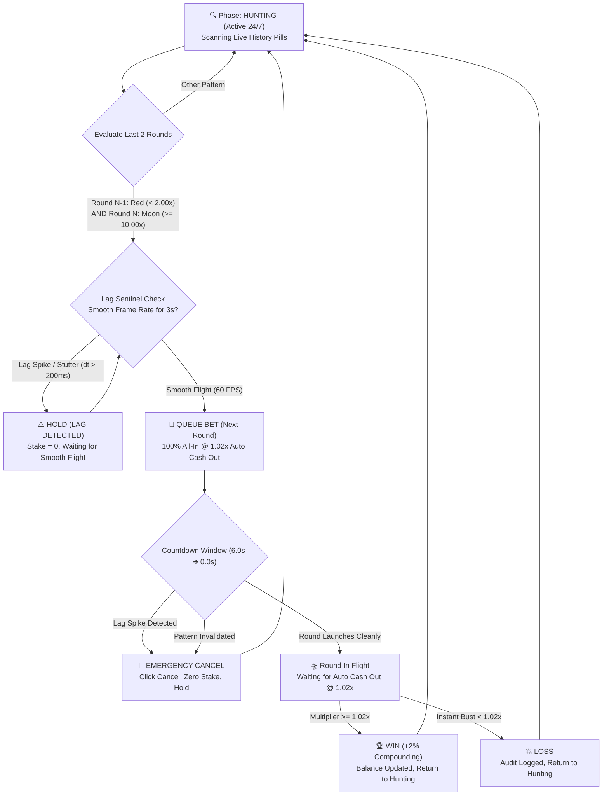

# BC.Game Crash SafeBot: Red ➔ Moon Protocol

> [!CAUTION]
> **CRITICAL ARCHITECTURAL DIRECTIVE FOR ALL AGENTS**
> Every AI agent operating in this project is strictly barred from modifying the `1.02×` cashout target, the 100% All-In stake allocation, the `Red -> Moon` trigger pattern, the lag motion sentinel, or the emergency queued bet cancellation engine. Only the human user has authority to order alterations.

---

## 1. Executive Summary

The engine executes an aggressive compounding model anchored by high mathematical win rates and real-time network/motion protection:
1. **The Target Multiplier**: **`1.02×`** Auto Cash Out (baseline win probability $\approx 97.06\%$).
2. **The Trigger Pattern**:
   * **Round $N-1$**: Any Red multiplier (**`1.00× – 1.99×`**). Prior rounds do not matter.
   * **Round $N$**: Any Moon multiplier (**`≥ 10.00×`**).
   * **Round $N+1$**: Staked immediately on the next round following the Moon crash.
3. **Continuous Active Hunting**: No hourly limits. Hunts 24/7 across all market hours.
4. **Pre-Flight Lag & Motion Sentinel**:
   * Measures `requestAnimationFrame` frame deltas in real time.
   * If frame jitter exceeds $200\text{ms}$ or the animation stutters, holding mode is engaged.
   * Requires 3 continuous seconds of smooth 60 FPS animation before permitting a stake.
5. **Emergency Queued Bet Abort**:
   * Active during the 6-second countdown window after a bet is queued.
   * If lag spikes occur or pattern verification fails, clicks **`Cancel`** immediately, zeros the stake, and reverts to standby.

---

## 2. Operational Specification

| Rule | Parameter | Implementation |
| :--- | :--- | :--- |
| **Auto Cash Out** | **`1.02×`** | Hardcoded into the betting panel. |
| **Stake Allocation** | **100% All-In** | Available balance extracted from `.rr-mask` and pre-staged continuously. |
| **Cadence** | **Continuous Hunting** | Uncapped 24/7 scanning. |
| **Pattern Setup** | **`Red (< 2.00×)` ➔ `Moon (≥ 10.00×)`** | Verified against top live pills (`pills[1] < 2.00 && pills[0] >= 10.00`). |
| **Execution Point** | **Immediate Next Round** | Clicks `Bet (Next Round)` / `Bet` right after the Moon crashes. |
| **Lag Detection** | **Animation Frame Delta Monitor** | `requestAnimationFrame` tracking. Halts if $\Delta t > 200\text{ms}$. |
| **Emergency Abort** | **Instant Queued Bet Cancel** | Clicks `Cancel` before round start if jitter spikes or pattern invalidates. |

---

## 3. State Machine Flowchart

---

## 4. Disaster Recovery & Injection Runbook

If the system or browser restarted:
1. Open BC.Game Crash tab: `preview_open` with `url: "https://bc.game/game/crash"`, `profileId: "default"`.
2. Evaluate `crash-agent/src/in-page-engine.js` into the tab via `preview_evaluate`.
3. Verify that the HUD mounts on the lower right showing:
   * `RED ➔ MOON PROTOCOL (1.02×)`
   * `CONTINUOUS`
   * `🟢 Smooth (60 FPS)`
   * `Phase: HUNTING`
