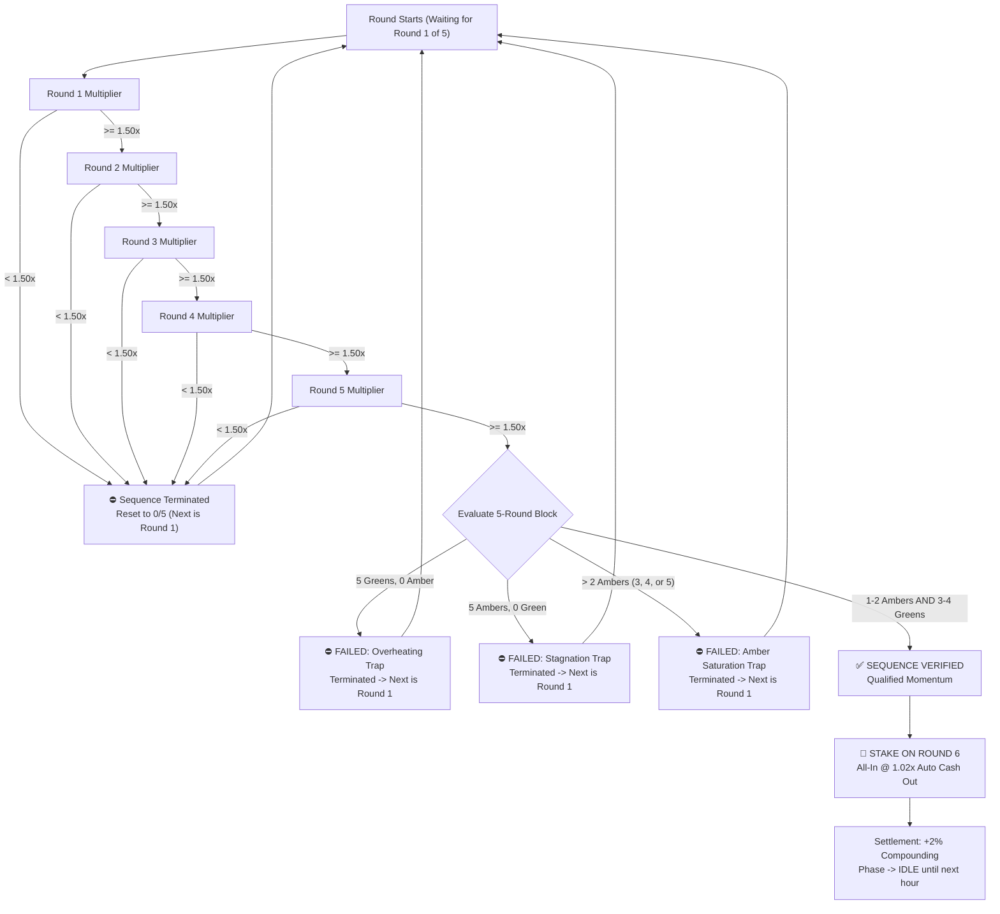

# BC.Game Crash SafeBot Protocol

> [!CAUTION]
> ### STRICT IMMUTABILITY DIRECTIVE — NON-NEGOTIABLE CORE LOCK
> **NO AGENT IS PERMITTED TO ALTER, REWRITE, LOOSEN, OR BYPASS ANY CORE RULE, THRESHOLD, OR CADENCE IN THIS PROTOCOL FOR ANY REASON.**
> Every agent inspecting or operating this project is barred from making changes to the core rules of this project, to this skill, or to the underlying execution engines unless the user explicitly, unambiguously instructs an exact change.
> Regardless of personal judgment, theoretical optimization, simulated edge, or perceived urgency, the agent has **ZERO AUTHORITY** to modify these rules.

---

## 1. Executive Summary & Purpose

The **BC.Game Crash SafeBot** is an institutional-grade, capital-preservation betting engine specifically designed for **BC.Game Crash** (`https://bc.game/game/crash`).

The engine exploits the mathematical safety of the extreme low-multiplier regime (**`1.02×`**) combined with a **Discrete Sequence Block Protocol** that eliminates the two most lethal statistical traps in Crash games:
1. **The Overheating Trap (Mean-Reversion Crash)**: Staking after a pure run of greens ($\ge 2.00\times$) where the house algorithm is primed to drop a kill-zone sub-$1.10\times$ crash.
2. **The Stagnation Trap (Low-Momentum Crash)**: Staking during a weak run of low ambers with zero upward momentum.

The engine runs as an **in-page DOM injection inside Chromium**, burning **0 LLM token credits** while continuously tracking, computing, and pre-staging in the background.

---

## 2. The Core Non-Negotiable Rules

| Parameter | Specification | Purpose / Rationale |
| :--- | :--- | :--- |
| **Auto Cash Out** | **`1.02×`** | 97.06% statistical win rate ($99 / 102$ provably fair formula). Generates clean +2% compounding per winning bet. |
| **Capital Allocation** | **100% All-In** | 100% of liquid balance is pre-staged continuously into the Bet Amount field. |
| **Cadence Limit** | **Strictly 1 Bet Per Hour** | Aligned to West African Time (`UTC+1`). Prevents over-trading and avoids high-frequency variance traps. |
| **Top-of-Hour Arming** | **Zero Observation Delay (0 min)** | From millisecond 0 of the hour (`HH:00:00.000` WAT), the bot is armed in `HUNTING (READY)` mode. |
| **Sequence Architecture** | **Discrete 5-Round Block** | Non-sliding block. Tracks rounds strictly from `1 of 5` to `5 of 5`. |
| **Threshold Minimum** | **$\ge 1.50\times$ on All 5 Rounds** | Every round inside the active block must clear $\ge 1.50\times$. |
| **Dual-Color Guardrail** | **Symmetric (Amber + Green)** | Must contain **$\ge 1$ Amber** ($1.50\times - 1.99\times$) AND **$\ge 1$ Green** ($\ge 2.00\times$). |
| **Amber Cap Guardrail** | **Maximum 2 Ambers** | Must contain **at most 2 Ambers** ($1.50\times - 1.99\times$). If $\ge 3$ Ambers ($3/5, 4/5, 5/5$), block **FAILS & TERMINATES** (Amber Saturation Trap). Reset to `1 of 5`. |
| **Trap Disqualification** | **$5/5$ Pure Greens, $5/5$ Pure Ambers, or $> 2$ Ambers** | Automatically **FAILS & TERMINATES**. Discarded immediately. |
| **Reset Behavior** | **Hard Reset to `1 of 5`** | Any sub-$1.50\times$ crash or failed 5-round block resets the sequence counter to 0. Next round is `1 of 5`. |
| **Execution Trigger** | **Round 6 Only** | Only when a block passes all 5 rounds does the bot stake on the **6th round of that sequence**. |
| **Post-Bet Behavior** | **Immediate IDLE** | Once resolved, increments hourly bets to `1/1`, pre-stages new balance, and remains `IDLE` until next hour. |

---

## 3. Discrete Sequence State Machine



---

## 4. Disaster Recovery & Cold-Start Runbook

If the host machine reboots, the browser crashes, or background tasks terminate, follow this exact step-by-step checklist to restore 100% autonomous operation:

### Step 1: Inspect Browser Tabs
Run `preview_status` to locate any existing tab running BC.Game Crash.
* If a tab exists and is owned by the agent, bring it to the foreground with:
  ```json
  { "tabId": "<TAB_ID>", "open": true }
  ```
* If no tab is open, open a fresh tab:
  ```json
  { "url": "https://bc.game/game/crash", "profileId": "default", "reuseExistingTab": false }
  ```

### Step 2: Verify Login & Balance
Run `preview_evaluate` to verify that the player account is signed in and liquid NGN balance is detected:
```javascript
(() => {
  const textNodes = Array.from(document.querySelectorAll('span, div')).filter(e => e.innerText && e.innerText.includes('NGN'));
  return textNodes.map(e => e.innerText.trim()).slice(0, 5);
})()
```

### Step 3: Inject the In-Page SafeBot Engine
Execute the self-contained engine script via `preview_evaluate` on the active game tab. (The complete standalone script is provided in Section 6 below).

### Step 4: Verify HUD & Pre-Staging Mount
Verify that:
1. `document.getElementById('__crash_bot_panel')` is visible on the bottom-right of the viewport.
2. `input[0]` (Bet Amount) is filled with 100% of liquid balance.
3. `input[1]` (Auto Cash Out) is filled with `1.02`.
4. Phase reflects either `HUNTING (READY)` (if bets for the hour are 0/1) or `IDLE` (if 1/1).

---

## 5. DOM Architecture & Critical Selectors

| Component | Selector / Method | Critical Handling |
| :--- | :--- | :--- |
| **Crash Pills** | `span.whitespace-nowrap.font-extrabold` | Pills are appended on the right. Must sort descending by `rect.x` (`b.x - a.x`) so index `0` is always the newest round. |
| **Bet Amount Input** | `document.querySelectorAll('input')[0]` | Dispatch native `input` and `change` events with bubbles enabled after setting value. |
| **Cash Out Input** | `document.querySelectorAll('input')[1]` | Value must be string `'1.02'`. Dispatch `input` and `change` events. |
| **Bet Button** | `button, div.button` matching `Bet` | Search by `b.innerText.startsWith('Bet') \|\| b.innerText.includes('Next Round')`. Click triggers stake for upcoming round. |
| **HUD Mount** | `#_crash_bot_panel` | Appended to `document.body` with `z-index: 2147483647` and high-contrast dark monospace styling. |

---

## 6. Complete Standalone Engine Script

Any agent in any new environment or workspace can copy this exact script and inject it directly into the page via `preview_evaluate`:

```javascript
(() => {
  if (window.__crash_bot_interval) {
    clearInterval(window.__crash_bot_interval);
    window.__crash_bot_interval = null;
  }

  const prevLogs = window.__CRASH_BOT__?.logs || [];
  const prevHistory = window.__CRASH_BOT__?.history || [];
  const now = new Date();
  const currentHourWAT = (now.getUTCHours() + 1) % 24;
  const prevHourWAT = window.__CRASH_BOT__?.currentHourWAT ?? currentHourWAT;
  
  const isSameHour = prevHourWAT === currentHourWAT;
  const currentBets = isSameHour ? (window.__CRASH_BOT__?.hourlyBetsPlaced || 0) : 0;
  const initialPhase = currentBets >= 1 ? 'idle' : 'ready';

  window.__CRASH_BOT__ = {
    active: true,
    autoBetEnabled: true,
    targetCashout: 1.02,
    currentHourWAT,
    phase: initialPhase,
    hourlyBetsPlaced: currentBets,
    maxBetsPerHour: 1,
    cycleStart: Date.now(),
    history: prevHistory,
    lastLoggedMult: null,
    
    currentSequence: [],
    sequenceStatus: 'Initial tracking: waiting for Round 1 of 5',
    lastFailedReason: null,
    readyToBetOnRound6: false,
    
    stats: window.__CRASH_BOT__?.stats || {
      totalTracked: prevHistory.length,
      burgundyCount: 0,
      brightRedCount: 0,
      lowAmberCount: 0,
      safeAmberCount: 0,
      greenCount: 0,
      current150Streak: 0,
      currentSub110Gap: 0
    },
    ruleConfig: {
      mode: 'DISCRETE_BLOCK_SEQUENCE',
      blockSize: 5,
      threshold: 1.50,
      requireAmber: true,
      requireGreen: true,
      amberMin: 1.50,
      amberMax: 1.99,
      greenMin: 2.00,
      autoCashout: 1.02,
      maxBetsPerHour: 1
    },
    liveBalance: window.__CRASH_BOT__?.liveBalance || 0,
    logs: prevLogs
  };

  function getLivePills() {
    const elements = Array.from(document.querySelectorAll('span.whitespace-nowrap.font-extrabold, span[class*="whitespace-nowrap"][class*="font-extrabold"]'))
      .filter(el => /^\d+(\.\d+)?[×x]$/.test(el.innerText.trim()));

    const positioned = elements.map(el => {
      const rect = el.getBoundingClientRect();
      const mult = parseFloat(el.innerText.trim().replace(/[^0-9.]/g, ''));
      return { mult, x: rect.x };
    }).filter(p => Number.isFinite(p.mult));

    positioned.sort((a, b) => b.x - a.x);
    return positioned.map(p => p.mult);
  }

  function processRoundInSequence(mult) {
    const b = window.__CRASH_BOT__;

    if (mult < 1.50) {
      b.currentSequence = [];
      b.readyToBetOnRound6 = false;
      b.lastFailedReason = `Round crashed at ${mult.toFixed(2)}× (< 1.50×). Sequence terminated.`;
      b.sequenceStatus = `⛔ Streak broken: ${mult.toFixed(2)}× is < 1.50×. Next round is 1 of 5.`;
      return;
    }

    b.currentSequence.push(mult);
    const count = b.currentSequence.length;

    if (count < 5) {
      b.readyToBetOnRound6 = false;
      b.lastFailedReason = null;
      b.sequenceStatus = `⏳ Sequence building: ${count} of 5 rounds completed (all >= 1.50×).`;
      return;
    }

    if (count === 5) {
      const seq = b.currentSequence;
      const amberCount = seq.filter(m => m >= 1.50 && m < 2.00).length;
      const greenCount = seq.filter(m => m >= 2.00).length;

      if (amberCount === 0) {
        b.currentSequence = [];
        b.readyToBetOnRound6 = false;
        b.lastFailedReason = `5/5 pure Greens (${greenCount} greens, 0 amber). Overheating trap. Sequence terminated.`;
        b.sequenceStatus = `⛔ FAILED: 5/5 pure Greens (0 Amber). Terminated! Next round is 1 of 5.`;
        b.logs.push(`[Sequence] Block failed: 5/5 pure Greens [${seq.join(', ')}]. Discarded.`);
        return;
      }

      if (greenCount === 0) {
        b.currentSequence = [];
        b.readyToBetOnRound6 = false;
        b.lastFailedReason = `5/5 pure Ambers (${amberCount} ambers, 0 green). Stagnation trap. Sequence terminated.`;
        b.sequenceStatus = `⛔ FAILED: 5/5 pure Ambers (0 Green). Terminated! Next round is 1 of 5.`;
        b.logs.push(`[Sequence] Block failed: 5/5 pure Ambers [${seq.join(', ')}]. Discarded.`);
        return;
      }

      if (amberCount > 2) {
        b.currentSequence = [];
        b.readyToBetOnRound6 = false;
        b.lastFailedReason = `Block contains ${amberCount} Ambers (max 2 allowed). Amber saturation trap. Terminated!`;
        b.sequenceStatus = `⛔ FAILED: ${amberCount} Ambers (Max 2 allowed). Terminated! Next round is 1 of 5.`;
        b.logs.push(`[Sequence] Block failed: ${amberCount} Ambers (> 2 max) [${seq.join(', ')}]. Discarded.`);
        return;
      }

      b.readyToBetOnRound6 = true;
      b.lastFailedReason = null;
      b.sequenceStatus = `✅ SEQUENCE PASSED: 5/5 (${amberCount} Amber, ${greenCount} Green). CLEAR TO STAKE ON ROUND 6!`;
      b.logs.push(`[Sequence] Block PASSED: [${seq.join(', ')}] with ${amberCount} Amber and ${greenCount} Green. Ready for round 6!`);
    }
  }

  function trackLiveRounds() {
    const pills = getLivePills();
    if (pills.length === 0) return;

    const newest = pills[0];
    if (newest !== window.__CRASH_BOT__.lastLoggedMult) {
      window.__CRASH_BOT__.lastLoggedMult = newest;

      if (window.__CRASH_BOT__.history[0] !== newest) {
        window.__CRASH_BOT__.history.unshift(newest);
        if (window.__CRASH_BOT__.history.length > 1000) {
          window.__CRASH_BOT__.history.pop();
        }
      }

      if (window.__CRASH_BOT__.phase === 'bet_placed') {
        const won = newest >= 1.02;
        const pnl = won ? (window.__CRASH_BOT__.liveBalance * 0.02) : -window.__CRASH_BOT__.liveBalance;
        window.__CRASH_BOT__.phase = 'idle';
        window.__CRASH_BOT__.readyToBetOnRound6 = false;
        window.__CRASH_BOT__.currentSequence = [];
        window.__CRASH_BOT__.logs.push({
          ts: new Date().toISOString(),
          event: 'bet_settled',
          targetMult: newest,
          won,
          pnl
        });
        console.log(`[Crash Bot] BET SETTLED! Round ended at ${newest.toFixed(2)}x -> ${won ? 'WIN (+1.02x)' : 'LOSS'}. Bot now IDLE until next hour.`);
      }

      processRoundInSequence(newest);

      const s = window.__CRASH_BOT__.stats;
      s.totalTracked = window.__CRASH_BOT__.history.length;
      
      const sub110Idx = window.__CRASH_BOT__.history.findIndex(m => m < 1.10);
      s.currentSub110Gap = sub110Idx === -1 ? window.__CRASH_BOT__.history.length : sub110Idx;

      let streak = 0;
      for (const m of window.__CRASH_BOT__.history) {
        if (m >= 1.50) streak++;
        else break;
      }
      s.current150Streak = streak;

      s.burgundyCount = window.__CRASH_BOT__.history.filter(m => m < 1.10).length;
      s.brightRedCount = window.__CRASH_BOT__.history.filter(m => m >= 1.10 && m < 1.20).length;
      s.lowAmberCount = window.__CRASH_BOT__.history.filter(m => m >= 1.20 && m < 1.50).length;
      s.safeAmberCount = window.__CRASH_BOT__.history.filter(m => m >= 1.50 && m < 2.00).length;
      s.greenCount = window.__CRASH_BOT__.history.filter(m => m >= 2.00).length;
    }
  }

  function updatePreStaging() {
    const walletEl = document.querySelector('.rr-mask');
    if (walletEl) {
      const match = walletEl.innerText.match(/NGN\s*([\d,]+\.?\d*)/);
      if (match) {
        const bal = parseFloat(match[1].replace(/,/g, ''));
        if (bal > 0) {
          window.__CRASH_BOT__.liveBalance = bal;
        }
      }
    } else {
      const textNodes = Array.from(document.querySelectorAll('header span, nav span, span, div')).filter(e => e.innerText && e.innerText.includes('NGN'));
      for (const node of textNodes) {
        const match = node.innerText.match(/NGN\s*([\d,]+\.?\d*)/);
        if (match) {
          const bal = parseFloat(match[1].replace(/,/g, ''));
          if (bal > 0 && bal < 500000) {
            window.__CRASH_BOT__.liveBalance = bal;
            break;
          }
        }
      }
    }

    const inputs = Array.from(document.querySelectorAll('input'));
    if (inputs.length >= 2) {
      const amountInput = inputs[0];
      const cashoutInput = inputs[1];

      if (cashoutInput.value !== '1.02') {
        cashoutInput.value = '1.02';
        cashoutInput.dispatchEvent(new Event('input', { bubbles: true }));
        cashoutInput.dispatchEvent(new Event('change', { bubbles: true }));
      }

      const maxStake = (Math.floor(window.__CRASH_BOT__.liveBalance * 100) / 100).toFixed(2);
      if (amountInput.value !== maxStake && window.__CRASH_BOT__.liveBalance > 0) {
        amountInput.value = maxStake;
        amountInput.dispatchEvent(new Event('input', { bubbles: true }));
        amountInput.dispatchEvent(new Event('change', { bubbles: true }));
      }
    }
  }

  function executeBet(reason) {
    const betBtn = Array.from(document.querySelectorAll('button, div.button')).find(b => {
      const t = (b.innerText || '').trim();
      return t.startsWith('Bet') || t.includes('Bet\n') || t.includes('Next Round');
    });

    if (betBtn && !betBtn.disabled) {
      console.log(`[Crash Bot] EXECUTING BET on 6th Round! Reason: ${reason}`);
      betBtn.click();
      window.__CRASH_BOT__.hourlyBetsPlaced++;
      window.__CRASH_BOT__.phase = 'bet_placed';
      window.__CRASH_BOT__.readyToBetOnRound6 = false;
      window.__CRASH_BOT__.currentSequence = [];
      window.__CRASH_BOT__.logs.push({
        ts: new Date().toISOString(),
        event: 'bet_placed',
        cashout: 1.02,
        stake: window.__CRASH_BOT__.liveBalance,
        reason
      });
      return true;
    }
    return false;
  }

  function updatePanelUI() {
    let panel = document.getElementById('__crash_bot_panel');
    if (!panel) {
      panel = document.createElement('div');
      panel.id = '__crash_bot_panel';
      panel.style.cssText = `
        position: fixed;
        bottom: 12px;
        right: 12px;
        width: 360px;
        background: rgba(9, 13, 18, 0.97);
        border: 1px solid #2a3540;
        border-radius: 10px;
        padding: 12px;
        font-family: ui-monospace, Menlo, monospace;
        font-size: 11px;
        color: #e6edf3;
        z-index: 2147483647;
        box-shadow: 0 8px 28px rgba(0,0,0,0.55);
      `;
      document.body.appendChild(panel);
    }

    const b = window.__CRASH_BOT__;
    const s = b.stats;
    const nowWAT = new Date().toLocaleTimeString('en-US', { timeZone: 'Africa/Lagos' });
    const seq = b.currentSequence || [];
    const ambers = seq.filter(m => m >= 1.50 && m < 2.00).length;
    const greens = seq.filter(m => m >= 2.00).length;

    const seqPills = seq.length > 0 ? seq.map((m, idx) => {
      const isAmber = m >= 1.50 && m < 2.00;
      const bg = isAmber ? '#b08800' : '#238636';
      const label = isAmber ? 'A' : 'G';
      return `<span style="background:${bg}; color:#fff; padding:2px 5px; border-radius:4px; font-weight:bold; margin-right:4px;">#${idx+1}: ${m.toFixed(2)}× (${label})</span>`;
    }).join('') : '<span style="color:#8b949e; font-style:italic;">Empty (waiting for Round 1 of 5)</span>';

    panel.innerHTML = `
      <div style="display:flex; justify-content:space-between; align-items:center; margin-bottom:8px; border-bottom:1px solid #2a3540; padding-bottom:6px;">
        <div style="font-weight:bold; font-size:12px; color:#58a6ff;">DISCRETE SEQUENCE BLOCK (1.02×)</div>
        <div style="color:#7ee787; font-weight:bold;">${nowWAT}</div>
      </div>

      <div style="margin-bottom:8px; background:#161b22; padding:6px 8px; border-radius:6px;">
        <div style="color:#8b949e; font-size:10px;">BALANCE & PRE-STAGE (ALL-IN)</div>
        <div style="display:flex; justify-content:space-between; margin-top:2px;">
          <span>NGN <b>${b.liveBalance.toFixed(2)}</b> (100%)</span>
          <span style="color:#58a6ff; font-weight:bold;">Auto Cash: 1.02×</span>
        </div>
      </div>

      <div style="margin-bottom:8px; background:#161b22; padding:6px 8px; border-radius:6px;">
        <div style="display:flex; justify-content:space-between; color:#8b949e; font-size:10px; margin-bottom:4px;">
          <span>ACTIVE BLOCK SEQUENCE</span>
          <span style="color:#58a6ff; font-weight:bold;">${seq.length} of 5</span>
        </div>
        <div style="display:flex; align-items:center; flex-wrap:wrap; gap:3px; min-height:22px;">${seqPills}</div>
      </div>

      <div style="margin-bottom:8px; background:#161b22; padding:6px 8px; border-radius:6px;">
        <div style="color:#8b949e; font-size:10px;">SEQUENCE STATUS & GUARDRAILS</div>
        <div style="font-weight:bold; color:${b.readyToBetOnRound6 ? '#3fb950' : (b.lastFailedReason ? '#f85149' : '#e6edf3')}; margin-top:3px;">
          ${b.sequenceStatus}
        </div>
        <div style="display:flex; justify-content:space-between; font-size:10px; color:#8b949e; margin-top:4px;">
          <span>Amber (1-2): <b style="color:${ambers >= 1 && ambers <= 2 ? '#3fb950' : (ambers > 2 ? '#f85149' : '#8b949e')};">${ambers}/2</b></span>
          <span>Green (>=1): <b style="color:${greens >= 1 ? '#3fb950' : '#8b949e'};">${greens}</b></span>
          <span>Block Valid: <b style="color:${b.readyToBetOnRound6 ? '#3fb950' : '#f85149'};">${b.readyToBetOnRound6 ? 'YES' : 'NO'}</b></span>
        </div>
      </div>

      <div style="background:#161b22; padding:6px 8px; border-radius:6px; margin-bottom:8px; font-size:10px;">
        <div style="color:#8b949e; margin-bottom:2px;">LIVE MULTI-ROUND TRACKER</div>
        <div style="display:flex; justify-content:space-between; color:#c9d1d9;">
          <span>Tracked: <b>${s.totalTracked}</b></span>
          <span>Sub-1.10 Gap: <b style="color:${s.currentSub110Gap >= 4 ? '#3fb950' : '#f85149'};">${s.currentSub110Gap} rds</b></span>
          <span>1.50+ Streak: <b>${s.current150Streak}</b></span>
        </div>
      </div>

      <div style="display:flex; justify-content:space-between; align-items:center; font-size:10px; color:#8b949e;">
        <span>Hour Bet: <b>${b.hourlyBetsPlaced}/${b.maxBetsPerHour}</b></span>
        <span>Phase: <b style="color:${b.phase === 'ready' ? '#3fb950' : '#58a6ff'};">${b.phase === 'ready' ? 'HUNTING (READY)' : b.phase.toUpperCase()}</b></span>
      </div>
    `;
  }

  window.__crash_bot_interval = setInterval(() => {
    trackLiveRounds();
    updatePreStaging();
    updatePanelUI();

    const now = new Date();
    const currentHourWAT = (now.getUTCHours() + 1) % 24;

    if (window.__CRASH_BOT__.currentHourWAT !== currentHourWAT) {
      window.__CRASH_BOT__.currentHourWAT = currentHourWAT;
      window.__CRASH_BOT__.hourlyBetsPlaced = 0;
      window.__CRASH_BOT__.phase = 'ready';
      window.__CRASH_BOT__.currentSequence = [];
      window.__CRASH_BOT__.readyToBetOnRound6 = false;
      window.__CRASH_BOT__.cycleStart = Date.now();
      window.__CRASH_BOT__.logs.push(`[${now.toLocaleTimeString()}] Hour ${currentHourWAT}:00 WAT struck! Zero observation delay - discrete sequence tracking active.`);
      console.log(`[Crash Bot] Top of hour ${currentHourWAT}:00 WAT struck! Zero observation delay - discrete sequence tracking active.`);
    }

    if (window.__CRASH_BOT__.autoBetEnabled &&
        window.__CRASH_BOT__.phase === 'ready' &&
        window.__CRASH_BOT__.hourlyBetsPlaced < window.__CRASH_BOT__.maxBetsPerHour &&
        window.__CRASH_BOT__.readyToBetOnRound6) {
      executeBet(window.__CRASH_BOT__.sequenceStatus);
    }
  }, 1000);

  return "Discrete Sequence Block Protocol Installed & Active!";
})();
```
